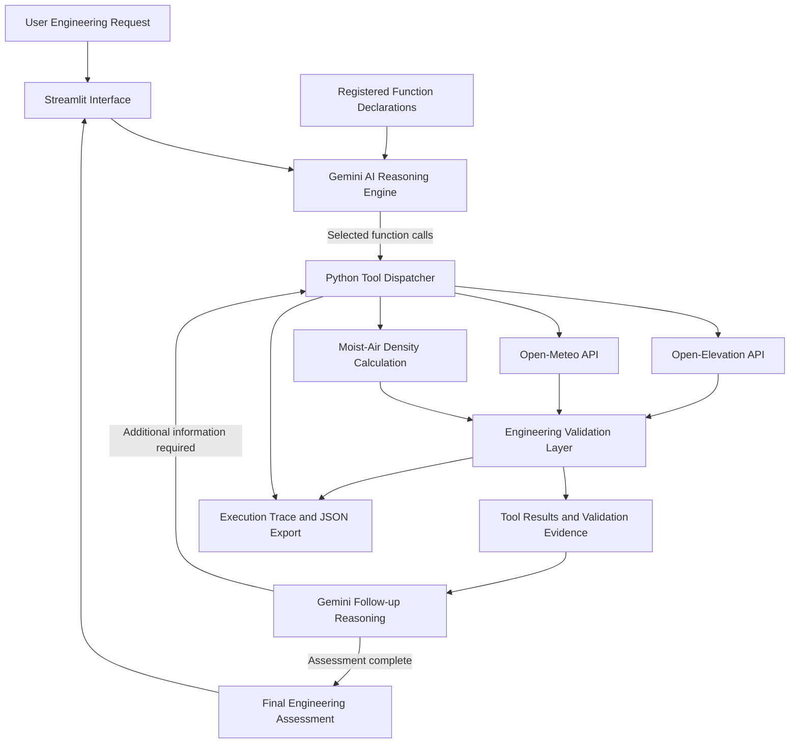
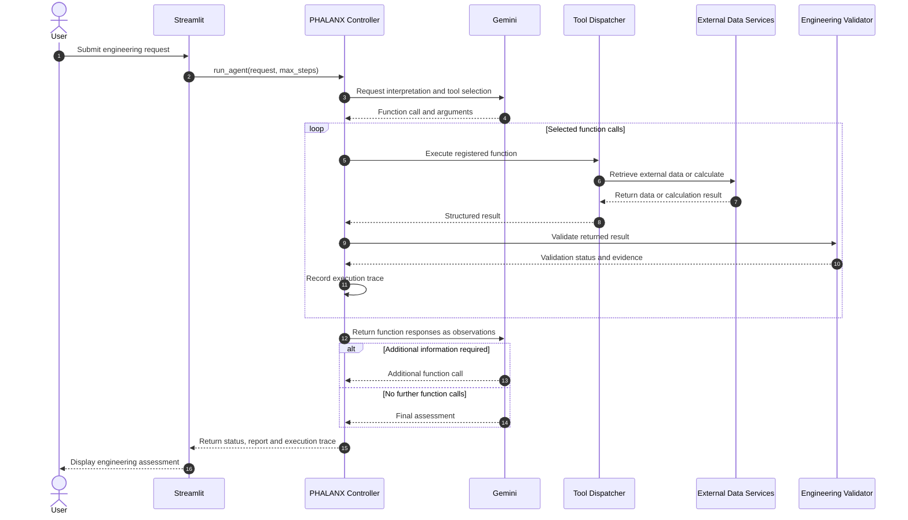

PHALANX-AI: An AI Agent for Automated Environmental Data Retrieval and Engineering Assessment


---
Executive Summary
Environmental engineering assessments frequently require information from multiple sources and the application of several calculations before a meaningful conclusion can be reached. An assessment of atmospheric conditions at a geographical location, for example, may require retrieving weather information, obtaining terrain elevation, determining atmospheric temperature, pressure and relative humidity, calculating air density, and checking whether the resulting values are physically and numerically consistent.
Although these operations can be performed using existing software tools, they are generally treated as separate tasks. The user must identify the required information, access the appropriate data sources, transfer the retrieved values into engineering calculations, and interpret the resulting outputs.
PHALANX-AI is being developed to automate this workflow through an AI agent capable of selecting and operating engineering tools in response to a user's request.
The system uses Google's Gemini language model as its decision-making and orchestration component. When a user submits an environmental engineering assessment request, Gemini interprets the requirement and determines which registered tools are needed. These tools are implemented in Python and currently provide three capabilities:
Retrieval of geographical terrain elevation through the Open-Elevation API.
Retrieval of model-based atmospheric conditions through the Open-Meteo API.
Calculation of moist-air density using temperature, absolute pressure and relative humidity.
Unlike a conventional chatbot that primarily generates answers through language prediction, PHALANX-AI can request information from external services and execute deterministic engineering calculations. The outputs of these operations are returned to the language model as observations. The model can then use the retrieved information to determine whether further tool execution is necessary before preparing its final assessment.
An independent engineering validation layer is implemented to examine the numerical outputs of the air-density calculation. It recalculates the expected moist-air and dry-air densities using the governing thermodynamic equations and compares these values against the outputs returned by the calculation tool. Invalid inputs and inconsistent numerical results are rejected rather than treated as verified engineering outputs.
The complete application is presented through a Streamlit interface, allowing users to specify geographical coordinates, submit assessment instructions, observe the tools selected by the agent, inspect their inputs and outputs, review validation evidence and export the execution record.
The current implementation demonstrates how language-model-driven decision-making can be combined with external data retrieval, deterministic engineering computation and numerical verification to automate a multi-step environmental assessment workflow.
---
Key Features
Natural-Language Engineering Requests: Accepts engineering assessment instructions in natural language rather than requiring users to manually select every computational operation.
AI-Based Tool Selection: Uses Gemini function calling to determine which registered engineering functions are relevant to the user's request.
Multi-Step Tool Orchestration: Allows the language model to request multiple tools and receive their outputs before deciding whether additional operations are required.
Geospatial Elevation Retrieval: Obtains terrain elevation in metres for specified geographic coordinates using the Open-Elevation REST API.
Atmospheric Data Retrieval: Retrieves model-based weather information from Open-Meteo, including temperature, relative humidity, apparent temperature, precipitation, cloud cover, atmospheric pressure, wind speed, wind direction and gusts.
Moist-Air Density Calculation: Calculates atmospheric density using an ideal-gas mixture formulation that accounts for the individual contributions of dry air and water vapour.
Buck Saturation Vapour Pressure Model: Calculates saturation vapour pressure as a function of temperature using the Buck equation.
Dry-Air Comparison: Calculates density under the dry-air assumption and compares it with the moist-air result to quantify the influence of water vapour.
Independent Numerical Validation: Recalculates expected moist-air and dry-air densities through a separate validation function and compares them against the reported calculation outputs.
Physical Input Constraints: Checks absolute temperature, positive absolute pressure, relative humidity limits, numeric types and finite calculation results.
Validation Rejection Safeguard: Records rejected engineering results and prevents the agent from returning a normal completed assessment when a recorded validation rejection exists.
Controlled Python Execution: Uses an explicit tool allowlist to restrict execution to registered engineering functions.
Execution Traceability: Records tool names, arguments, execution status, validation status and returned results for inspection.
Interactive Engineering Dashboard: Provides a Streamlit interface for assessment configuration, execution monitoring, engineering report display and JSON export.
---
Technology Stack
Component	Technology
Programming language	Python
Artificial intelligence	Google Gemini
LLM integration	Google Gen AI SDK
Agent orchestration	Custom function-calling loop
User interface	Streamlit
HTTP communication	Requests
Environmental weather data	Open-Meteo API
Terrain elevation data	Open-Elevation API
Engineering computation	Python mathematical functions
Numerical verification	Independent Python calculation
Configuration	python-dotenv
Data interchange	JSON
Version control	Git and GitHub
---
System Architecture
PHALANX-AI is organised into five principal functional layers.
User Interaction Layer: Receives the assessment request and displays the resulting report.
AI Reasoning Layer: Interprets the request and selects the appropriate engineering tools.
Tool Execution Layer: Executes the selected Python functions and retrieves external data.
Engineering Computation and Validation Layer: Performs deterministic calculations and evaluates numerical outputs.
Reporting Layer: Returns tool observations to the language model and presents the final assessment and execution record.
1. High-Level System Architecture

2. What Makes PHALANX-AI an Agentic System?
A conventional chatbot receives a question and generates a response. It does not necessarily interact with external engineering software, execute calculations or observe the results of its actions.
PHALANX-AI introduces an additional execution layer.
The language model is given a set of registered engineering tools. It interprets the user's request, selects the functions it considers necessary and supplies the required arguments. Python executes those functions and returns their results to the model.
The model can then examine the returned information and decide whether another operation is necessary.
This creates an iterative interaction between reasoning and execution.
The main characteristics of the agent are:
Task interpretation: The model interprets the user's natural-language assessment requirement.
Tool selection: It selects from the registered engineering functions rather than relying exclusively on generated text.
Action execution: The selected functions are executed by Python through a controlled dispatcher.
Observation: Returned data and validation evidence are incorporated into the conversation history.
Further decision-making: The model can request additional tools based on the information received.
Termination: The agent returns a final response when no further function calls are requested, subject to its validation safeguards and orchestration limit.
This is a bounded tool-using agent. It does not currently possess persistent memory, unrestricted autonomy or independent long-term planning.
3. Agent Execution Sequence

4. Agent Orchestration and Execution Control
The main orchestration function is:
```python
run_agent(user_request, max_steps=5)
```
The execution process is:
Validate the user request.
Initialise the conversation history.
Send the request and registered tools to Gemini.
Receive the model response.
Identify any structured function calls.
Execute the selected Python functions.
Validate the returned engineering results.
Record the arguments, results and validation evidence.
Return the observations to Gemini.
Continue the process if additional function calls are requested.
Return the final status and report when the model finishes.
The maximum number of orchestration rounds is configurable between 1 and 10.
Multiple function calls can be executed within a single round.
The current implementation supports three final execution states:
Status	Meaning
`COMPLETED`	The model finished its tool-calling sequence without a recorded engineering validation rejection.
`VALIDATION_REJECTED`	At least one engineering result failed validation.
`STEP_LIMIT_REACHED`	The maximum number of orchestration rounds was exhausted.
The system retains rejected validation records even if the language model attempts another calculation.
---
Engineering Tools and Data Acquisition
The current version exposes three Python functions to Gemini through structured function declarations.
1. Geographical Terrain Elevation
Function:
```python
get_elevation(latitude, longitude)
```
API:
```text
https://api.open-elevation.com/api/v1/lookup
```
The function accepts latitude and longitude in decimal degrees and retrieves the corresponding terrain elevation.
Input constraints:
$$
-90\leq Latitude\leq90
$$
$$
-180\leq Longitude\leq180
$$
Returned information includes:
Latitude.
Longitude.
Elevation in metres.
Data source.
Data classification.
The retrieved elevation represents geographic terrain information from an external elevation dataset. It is not a real-time measurement.
2. Atmospheric Weather Retrieval
Function:
```python
get_weather(latitude, longitude)
```
API:
```text
https://api.open-meteo.com/v1/forecast
```
The function requests the following atmospheric variables:
Variable	Description	Unit
`temperature_2m`	Air temperature at 2 m	°C
`relative_humidity_2m`	Relative humidity at 2 m	%
`apparent_temperature`	Apparent temperature	°C
`precipitation`	Total precipitation	mm
`rain`	Rainfall	mm
`showers`	Showers	mm
`weather_code`	Weather classification code	Code
`cloud_cover`	Cloud cover	%
`pressure_msl`	Mean sea-level pressure	hPa
`surface_pressure`	Surface atmospheric pressure	hPa
`wind_speed_10m`	Wind speed at 10 m	m/s
`wind_direction_10m`	Wind direction at 10 m	Degrees
`wind_gusts_10m`	Wind gust speed at 10 m	m/s
The weather function returns the current data object, associated units, elevation information, timezone and source identification.
The retrieved weather values are model-based data products. They should not be interpreted as direct measurements from an installed meteorological station.
3. Moist-Air Density Calculation
Function:
```python
calculate_air_density(
    temperature_c,
    pressure_hpa,
    relative_humidity_pct
)
```
The calculation uses:
Air temperature in degrees Celsius.
Absolute atmospheric pressure in hectopascals.
Relative humidity in percentage.
The output includes:
Moist-air density.
Dry-air density.
Percentage density difference.
Absolute temperature.
Atmospheric pressure in pascals.
Water-vapour partial pressure.
Dry-air partial pressure.
Calculation method and assumptions.
The governing equations are detailed in the following section.
---
Governing Equations
1. Ideal Gas Equation of State
The ideal gas equation is:
$$
PV=mRT
$$
Rearranging:
$$
\boxed{\rho=\frac{P}{RT}}
$$
Where:
(P): Absolute pressure (Pa).
(V): Volume (m³).
(m): Mass (kg).
(R): Specific gas constant (J kg⁻¹ K⁻¹).
(T): Absolute temperature (K).
(\rho): Density (kg/m³).
For moist air, the gas mixture consists primarily of dry air and water vapour.
The density of the mixture is therefore calculated from the contributions of the individual constituents.
2. Moist-Air Mixture Equation
Using the ideal-gas mixture formulation:
$$
\rho_{ma}=\rho_d+\rho_v
$$
The individual density contributions are:
$$
\rho_d=\frac{P_d}{R_dT}
$$
$$
\rho_v=\frac{P_v}{R_vT}
$$
Therefore:
$$
\boxed{
\rho_{ma}=
\frac{P_d}{R_dT}
+
\frac{P_v}{R_vT}
}
$$
Where:
(\rho_{ma}): Moist-air density (kg/m³).
(P_d): Dry-air partial pressure (Pa).
(P_v): Water-vapour partial pressure (Pa).
(R_d=287.05) J kg⁻¹ K⁻¹.
(R_v=461.495) J kg⁻¹ K⁻¹.
(T): Absolute temperature (K).
3. Temperature and Pressure Conversion
Temperature conversion:
$$
T_K=T_C+273.15
$$
Pressure conversion:
$$
P_{Pa}=100P_{hPa}
$$
The implementation uses absolute pressure rather than gauge pressure.
4. Saturation Vapour Pressure — Buck Equation
The saturation vapour pressure is calculated using the Buck equation:
$$
\boxed{
e_s(T_C)=6.1121
\exp\left[
\left(18.678-\frac{T_C}{234.5}\right)
\left(\frac{T_C}{257.14+T_C}\right)
\right]
}
$$
Where:
(e_s): Saturation vapour pressure (hPa).
(T_C): Temperature (°C).
The implementation uses the liquid-water formulation.
5. Actual Water-Vapour Partial Pressure
Relative humidity is related to actual vapour pressure through:
$$
RH=100\frac{P_v}{e_s}
$$
Rearranging:
$$
\boxed{
P_v=\frac{RH}{100}e_s
}
$$
The calculated vapour pressure is converted into pascals before being used in the density equation.
6. Dry-Air Partial Pressure
Using Dalton's law:
$$
P=P_d+P_v
$$
Therefore:
$$
\boxed{P_d=P-P_v}
$$
7. Final Moist-Air Density
Substituting the partial pressures into the mixture equation:
$$
\boxed{
\rho_{ma}=
\frac{P-P_v}{R_dT}
+
\frac{P_v}{R_vT}
}
$$
This is the primary thermodynamic equation implemented in the Python calculation tool.
8. Dry-Air Density Comparison
The dry-air approximation is calculated as:
$$
\boxed{
\rho_{dry}=\frac{P}{R_dT}
}
$$
The percentage difference is:
$$
\boxed{
\Delta\rho_{%}=
\frac{\rho_{dry}-\rho_{ma}}{\rho_{dry}}\times100
}
$$
This provides a comparison between the dry-air approximation and the moist-air mixture calculation.
Because water vapour has a higher specific gas constant than dry air, it contributes less mass per unit pressure at the same temperature.
Consequently, increasing water-vapour content generally reduces moist-air density relative to the dry-air approximation at the same total pressure and temperature.
---
Engineering Validation Layer
An important component of PHALANX-AI is the separation of engineering calculation from numerical verification.
The density calculation is performed by:
```python
calculate_air_density()
```
The returned result is subsequently evaluated by:
```python
validate_engineering_result(
    tool_name,
    arguments,
    result
)
```
The validation routine independently implements the mathematical equations to determine expected density values.
1. Input Validation
The validation layer checks:
$$
T_C>-273.15^\circ C
$$
$$
P>0
$$
$$
0\leq RH\leq100
$$
It also checks:
Numeric input types.
Rejection of Boolean values as numeric inputs.
Finite input values.
Positive dry-air partial pressure.
Positive finite density outputs.
2. Independent Numerical Recalculation
The expected moist-air density is calculated again:
$$
\rho_{ma,ref}=
\frac{P-P_v}{R_dT}
+
\frac{P_v}{R_vT}
$$
The expected dry-air density is:
$$
\rho_{dry,ref}=\frac{P}{R_dT}
$$
The reported outputs are compared with these reference calculations.
3. Numerical Error
The absolute error is:
$$
E_{abs}=|\rho_{reported}-\rho_{reference}|
$$
The configured numerical tolerance is:
$$
\boxed{\epsilon=0.00015;kg/m^3}
$$
A result passes when:
$$
E_{abs}\leq\epsilon
$$
Both moist-air and dry-air density values are evaluated.
4. Validation Outcomes
Status	Interpretation
`PASSED`	Applicable engineering checks have passed.
`REJECTED`	An input or numerical output has failed validation.
`NOT_APPLICABLE`	No dedicated engineering validation rule exists for the tool.
The weather and elevation functions currently do not have dedicated independent engineering-data validation models. Their coordinate checks, HTTP status checks and response handling are implemented within the retrieval functions.
Important limitation: The independent validation function reimplements the same mathematical model and constants. It checks numerical consistency between two implementations; it does not independently establish the physical accuracy of the model or replace experimental validation.
5. Rejection Safeguard
When a calculation fails validation:
The result is marked `REJECTED`.
The validation errors are recorded.
The result is returned to Gemini with an explicit instruction that it must not be treated as verified engineering data.
The rejection is retained in the agent's execution state.
A normal `COMPLETED` report is prevented when the model finishes its tool-calling sequence.
This is a computational reliability safeguard. It does not guarantee that every possible incorrect statement in a generated report will be detected.
---
Installation and Execution
Prerequisites
Windows, Linux or macOS.
Python 3.10 or later.
Git.
Google Gemini API key.
Internet connectivity.
1. Clone the Repository
```bash
git clone https://github.com/SreeVidhyaBhaskar/PHALANX-AI.git

cd PHALANX-AI
```
2. Create a Virtual Environment
Windows:
```powershell
python -m venv .venv

.\.venv\Scripts\Activate.ps1
```
Linux/macOS:
```bash
python -m venv .venv

source .venv/bin/activate
```
3. Install Dependencies
```bash
python -m pip install --upgrade pip

pip install -r requirements.txt
```
4. Configure Gemini API Credentials
Create a `.env` file in the project root:
```text
GEMINI_API_KEY=your_api_key_here
```
The application loads the API key using:
```python
from dotenv import load_dotenv

load_dotenv()

API_KEY = os.getenv("GEMINI_API_KEY")
```
Do not upload `.env` or expose API credentials in the repository.
5. Run PHALANX-AI
Launch the new civilian engineering application:
```bash
python -m streamlit run app_civilian.py
```
The application will provide a local URL, typically:
```text
http://localhost:8501
```
The original `app.py` is retained separately and is not the entry point for the current civilian engineering agent.
---
Application Interface
The Streamlit interface provides the following functionality:
Assessment Configuration
Geographic latitude.
Geographic longitude.
Maximum orchestration rounds.
Registered engineering tool information.
Assessment Request
The user can modify the natural-language assessment instructions and submit a request to the agent.
Engineering Assessment Results
Displays the final response generated by Gemini and the execution status.
Agent Execution Trace
For every executed function, the interface displays:
Orchestration round.
Tool name.
Tool arguments.
Execution status.
Validation status.
Validation evidence.
Returned tool result.
Rejected Engineering Results
Displays recorded validation failures and associated error messages.
Execution Summary
Displays:
Agent status.
Total tool calls.
Number of orchestration rounds.
JSON Export
Allows the complete execution record to be exported for inspection and reproducibility.
---
Project Structure
```text
PHALANX-AI/
│
├── agent.py
│   ├── Configuration and Gemini initialization
│   ├── System instruction
│   ├── get_elevation()
│   ├── get_weather()
│   ├── calculate_air_density()
│   ├── Function declarations
│   ├── Registered tool definitions
│   ├── execute_tool()
│   ├── validate_engineering_result()
│   └── run_agent()
│
├── app_civilian.py
│   ├── Streamlit configuration
│   ├── User interface
│   ├── Assessment configuration
│   ├── Request submission
│   ├── Agent execution
│   ├── Result presentation
│   ├── Execution trace
│   └── JSON export
│
├── app.py
│   └── Original application retained separately
│
├── requirements.txt
├── .gitignore
├── .env
├── .env.example
└── README.md
```
The repository also contains development backups and test scripts. They are not all runtime dependencies of the application.
---
Testing and Verification
The development process includes tests for the engineering calculation, input constraints, numerical validation and agent completion safeguards.
The test scripts include:
Test	Purpose
`test_validation.py`	Checks valid density calculations and invalid humidity input.
`test_independent_validation.py`	Checks numerical consistency and corrupted output rejection.
`test_rejection_guard.py`	Checks that a rejected result cannot produce normal completion.
`test_success_guard.py`	Checks that a valid calculation can complete normally.
`test_agent_v3.py` and later versions	Tests agent tool-calling behaviour and multi-step execution.
The local validation and safeguard tests have previously passed.
Earlier live Gemini tests also demonstrated multi-round tool selection. However, live API execution is subject to provider availability and quota. A successful local validation test does not establish that the external Gemini service is currently available.
Run the individual test scripts using:
```powershell
.\.venv\Scripts\python.exe .\test_validation.py

.\.venv\Scripts\python.exe .\test_independent_validation.py

.\.venv\Scripts\python.exe .\test_rejection_guard.py

.\.venv\Scripts\python.exe .\test_success_guard.py
```
---
Limitations and Future Development
Current Limitations
The agent operates within a bounded function-calling loop rather than unrestricted autonomous planning.
Gemini tool selection and natural-language interpretation may contain errors.
Weather information is model-based rather than direct sensor telemetry.
Elevation information depends on the accuracy of the external geographic dataset.
Moist-air calculations assume ideal-gas mixture behaviour.
The Buck equation implementation uses a liquid-water saturation formulation.
The numerical validator checks consistency using the same underlying physical model.
The current implementation does not establish experimental accuracy through comparison with calibrated instruments.
Weather and elevation tools do not yet have dedicated independent engineering validation rules.
The application does not implement comprehensive verification of every factual claim in the final LLM-generated narrative.
API availability and execution are dependent on network connectivity, provider service availability and account quotas.
Future Development
Potential extensions include:
Additional thermodynamic property calculations.
Atmospheric boundary-layer calculations.
Integration of additional environmental data sources.
Experimental validation against calibrated meteorological instruments.
Uncertainty propagation and sensitivity analysis.
More comprehensive engineering validation methods.
Tool-specific input and output verification.
Stronger source provenance tracking.
Structured engineering report generation.
Persistent experiment records.
Expanded visualization of environmental parameters.
Automated regression testing and continuous integration.
These items are proposed development directions, not claims of currently implemented functionality.
---
License
Refer to the repository's `LICENSE` file for the applicable licensing terms. A license should be included in the repository before making a formal open-source licensing claim.
---
Disclaimer
PHALANX-AI is an experimental engineering software prototype intended for educational research, computational assessment and demonstration of LLM-driven engineering tool orchestration.
Environmental information is retrieved from external data services, while engineering outputs depend on the assumptions, equations and numerical implementation described in this documentation.
A successful software validation result does not establish experimental accuracy or real-world engineering suitability.
All engineering conclusions require appropriate domain review and, where applicable, comparison against validated experimental measurements.