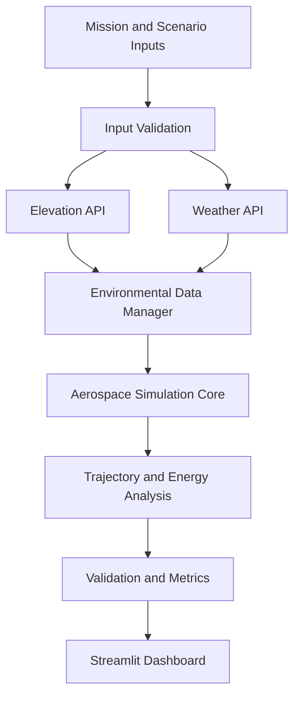

# PHALANX-AI: Autonomous Counter-DEW & Trajectory Optimization Core


## Executive Summary
**PHALANX-AI** is an agentic flight trajectory optimization platform designed for modern contested airspaces. Standard guidance planners optimize strictly for fuel efficiency and smooth pathing ($C^2$-continuous splines). However, in high-threat environments, smooth trajectories allow automated counter-measures—specifically High-Energy Lasers (HEL) and Directed Energy Weapons (DEW) like Israel's *Iron Beam*—to achieve steady target lock via Extended Kalman Filters (EKF).

PHALANX-AI solves this vulnerability by deploying a **Regime-Switched Adversarial Kinematic Engine**. It injects high-frequency, non-polynomial micro-jitter ($\mathbf{j} = \frac{d\mathbf{a}}{dt} \ge 12\text{--}15 \text{ m/s}^3$) strictly within engagement zones to break EKF predictive convergence and exceed tracking gimbal bandwidth limits ($\approx 15 \text{ Hz}$). This smears the laser focal spot across the fuselage, keeping thermal dwell time below the $2.0\text{-second}$ melt-through threshold while preserving battery endurance along transit segments.

The platform combines environmental data, numerical simulation, trajectory analysis, and interactive visualization in a unified application.

Its modular architecture supports experimentation with alternative trajectory-planning strategies while providing visual feedback on flight dynamics, energy consumption, and tracking uncertainty.

PHALANX-AI is intended for simulation, research, and educational purposes. Its outputs depend on the accuracy of the underlying models and input data and should not be interpreted as validated real-world flight-control or aircraft-survivability predictions.

---

## Key Features

- **Geospatial Elevation Integration:** Retrieves terrain-elevation data for supported geographic coordinates through the Open-Elevation API.
- **Atmospheric Data Integration:** Supports weather-data retrieval through OpenWeatherMap, with configurable handling of unavailable data.
- **Atmospheric Modeling:** Provides a framework for examining wind profiles and environmental effects on simulated trajectories.
- **Trajectory Analysis:** Evaluates path length, smoothness, acceleration, jerk, and other general flight-dynamics metrics.
- **Energy Analysis:** Compares estimated energy consumption across simulated trajectory scenarios.
- **Tracking Simulation:** Visualizes generic tracking error, measurement uncertainty, and estimator behavior in controlled simulations.
- **Interactive Dashboard:** Uses Streamlit and Plotly to display telemetry, trajectory plots, simulation parameters, and performance metrics.
- **Reproducible Experiments:** Supports configurable scenarios and explicit separation between measured, retrieved, and simulated data.

---

## Technology Stack

| Component | Technology |
|---|---|
| Programming language | Python 3.10+ |
| Interactive dashboard | Streamlit |
| Data processing | NumPy, Pandas |
| Scientific computing | SciPy |
| Interactive visualization | Plotly |
| Elevation data | Open-Elevation API |
| Weather data | OpenWeatherMap API |

The exact dependencies and supported versions are defined in `requirements.txt`.

---

## System Architecture



### Architecture Overview

1. **Input Layer:** Accepts simulation settings, initial conditions, and scenario parameters.
2. **Environmental Data Layer:** Retrieves elevation and weather information from configured data providers.
3. **Data Management Layer:** Validates retrieved data and handles missing or unavailable values.
4. **Simulation Core:** Computes simulated trajectory and environmental responses.
5. **Analysis Layer:** Calculates trajectory, energy, and tracking-related metrics.
6. **Visualization Layer:** Displays simulation results through an interactive Streamlit dashboard.

---

## Mathematical Foundations

The following equations provide examples of the physical and numerical relationships that can be investigated within the simulation. Their applicability depends on the assumptions and parameters implemented in the code.

### 1. Atmospheric Attenuation

A simplified Beer–Lambert relationship is:

$$I(r) = I_0 e^{-\alpha r}$$

Where:

- $I_0$: Initial intensity.
- $I(r)$: Intensity after propagation through the medium.
- $\alpha$: Atmospheric extinction coefficient.
- $r$: Propagation distance.

The coefficient and distance must use compatible units. This equation describes attenuation under a simplified propagation model and does not independently predict structural heating or material failure.

### 2. Trajectory Kinematics

The basic kinematic relationships are:

$$\mathbf{v}(t) = \frac{d\mathbf{x}}{dt}$$

$$\mathbf{a}(t) = \frac{d\mathbf{v}}{dt}$$

$$\mathbf{j}(t) = \frac{d\mathbf{a}}{dt}$$

Where:

- $\mathbf{x}$: Position vector.
- $\mathbf{v}$: Velocity vector.
- $\mathbf{a}$: Acceleration vector.
- $\mathbf{j}$: Jerk vector.

These quantities can be used to characterize trajectory smoothness and the dynamic behavior of a simulated vehicle.

### 3. Wind Profile

A simplified logarithmic atmospheric boundary-layer wind profile is:

$$U(z) = \frac{u_*}{\kappa} \ln\left(\frac{z-d}{z_0}\right)$$

Where:

- $U(z)$: Mean wind speed at height $z$.
- $u_*$: Friction velocity.
- $\kappa$: von Kármán constant.
- $d$: Zero-plane displacement height.
- $z_0$: Surface roughness length.

This approximation requires appropriate surface-layer assumptions and valid height inputs. It should not be treated as a universal atmospheric model.

### 4. Simplified Drag Power

For a simplified aerodynamic model:

$$D = \frac{1}{2}\rho v^2 C_D A$$

$$P_D = D \cdot v$$

Where:

- $D$: Aerodynamic drag force.
- $\rho$: Air density.
- $v$: Airspeed relative to the surrounding air.
- $C_D$: Drag coefficient.
- $A$: Reference area.
- $P_D$: Power associated with overcoming drag.

This is a simplified drag-power relationship, not a complete aircraft propulsion-power model.
---

## Project Structure

A suggested repository structure is:

```text
FlightSim-Agent/
├── app.py
├── requirements.txt
├── README.md
├── .gitignore
├── .env.example
├── src/
│   ├── __init__.py
│   ├── environment.py
│   ├── simulation.py
│   ├── trajectory_analysis.py
│   └── visualization.py
├── tests/
│   ├── test_environment.py
│   └── test_simulation.py
└── data/
    └── README.md
```
---

## Installation and Setup (Windows)

### Prerequisites

- Windows 10 or Windows 11.
- Python 3.10 or later.
- Git.
- Internet access for installing packages and retrieving external API data.

Verify your Python and Git installations:

```powershell
python --version
git --version
```

### Step 1: Clone the Repository

Replace `YOUR_USERNAME` with your actual GitHub username.

```powershell
git clone https://github.com/YOUR_USERNAME/FlightSim-Agent.git
cd FlightSim-Agent
```

If you already have the project downloaded, open PowerShell in the project directory instead.

### Step 2: Create a Virtual Environment

```powershell
python -m venv .venv
```

Activate the environment:

```powershell
.\.venv\Scripts\Activate.ps1
```

If PowerShell blocks script execution, you can activate the environment through Command Prompt instead:

```bat
.venv\Scripts\activate.bat
```

### Step 3: Install Dependencies

Upgrade pip:

```powershell
python -m pip install --upgrade pip
```

Install the project dependencies:

```powershell
pip install -r requirements.txt
```

If `requirements.txt` does not exist, create it with the dependencies actually imported by your application before running this command.

### Step 4: Configure Environment Variables

If the application uses OpenWeatherMap, obtain an API key from the provider and configure it as an environment variable.

For the current PowerShell session:

```powershell
$env:OPENWEATHERMAP_API_KEY = "YOUR_API_KEY"
```

Replace `YOUR_API_KEY` with your own key.

Do not commit API keys, passwords, or other secrets to GitHub.

If the application does not yet read this environment variable, implement that configuration in the relevant module before expecting it to work.

### Step 5: Run the Application

Start the Streamlit dashboard:

```powershell
python -m streamlit run app.py
```

Streamlit normally prints a local URL in the terminal. Open that URL in your browser.

To stop the application, press `Ctrl+C` in the terminal.

---

## Configuration and Data Sources

### Open-Elevation

Open-Elevation can provide elevation estimates for supported geographic coordinates.

The application should validate:

- Latitude and longitude ranges.
- HTTP response status.
- Response structure.
- Missing or invalid elevation values.
- Request failures and service availability.

Returned elevations should be interpreted according to the data provider's documentation. Do not assume that every elevation source uses an identical vertical datum.

### OpenWeatherMap

Weather integration requires valid API configuration and an available endpoint.

The application should handle:

- Missing API credentials.
- Network timeouts.
- HTTP errors and rate limits.
- Missing weather fields.
- Invalid or stale observations.
- Unit conversions and timestamps.

### Simulation Fallback

If external data cannot be retrieved, the application may use a clearly identified simulated dataset when appropriate.

Simulated data must be labeled as simulated in the dashboard. It should never be presented as live telemetry or real weather observations.

---

## Validation and Testing

Before relying on simulation results, validate the implementation using repeatable test cases.

Recommended checks include:

- Input validation for coordinates and simulation parameters.
- Unit consistency across physical equations.
- Numerical stability and finite-value checks.
- Handling of unavailable API responses.
- Consistency between plotted values and calculated metrics.
- Repeatability under identical initial conditions and random seeds.
- Comparison against analytical solutions for simplified test cases.

Run automated tests, if the repository contains them:

```powershell
python -m pytest
```

If pytest is not installed and is used by your test suite, install it in the virtual environment:

```powershell
python -m pip install pytest
```

---

## Known Limitations

- External APIs may be unavailable, rate-limited, or subject to service changes.
- Terrain and weather datasets have finite spatial and temporal resolution.
- Simplified aerodynamic models do not capture every aircraft configuration or flight condition.
- Numerical derivatives can amplify noise in sampled signals.
- Simulation accuracy depends on input quality, model assumptions, and implementation.
- A visually plausible trajectory is not proof of physical accuracy or real-world flightworthiness.
- Results have not been validated for operational flight-control applications unless independently demonstrated and documented.

---

## Roadmap

Potential development milestones include:

- [ ] Modular simulation and visualization components.
- [ ] Robust API integration and input validation.
- [ ] Explicit labeling of live, cached, and simulated data.
- [ ] Automated unit and regression tests.
- [ ] Scenario comparison and parameter sensitivity analysis.
- [ ] Reproducible experiment configuration and result export.
- [ ] Documentation of assumptions, model limitations, and validation results.

Roadmap items indicate intended development, not necessarily completed functionality.

---

## Contributing

Contributions that improve numerical reliability, software quality, documentation, visualization, or reproducibility are welcome.

1. Fork the repository.
2. Create a feature branch.
3. Make and test your changes.
4. Submit a pull request with a clear description of the changes.

Please include reproducible test cases for numerical or simulation-related changes.

---

## License

This project is licensed under the MIT License, subject to the terms of the repository's `LICENSE` file.

If the repository does not yet contain a `LICENSE` file, add one before describing the project as MIT-licensed.

---

## Disclaimer

PHALANX-AI is intended for research, educational, and simulation purposes. It does not replace validated engineering analysis, certified flight-control systems, or qualified aerospace engineering review.

All results should be interpreted in the context of the models, assumptions, data sources, and validation procedures used.
